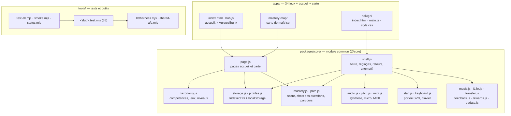
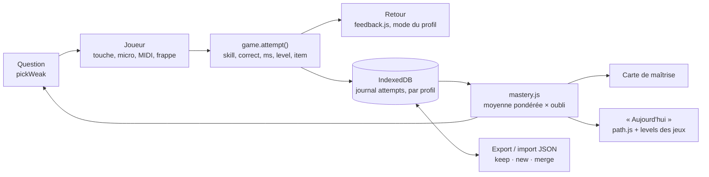
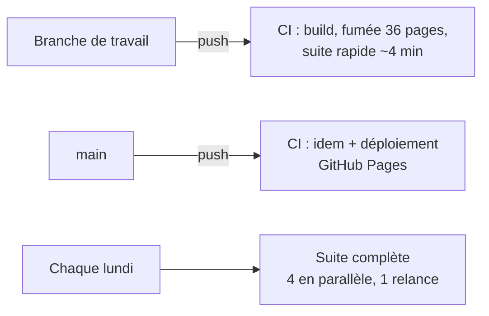

# Architecture

Référence détaillée de l'API commune : [packages/core/README.md](../../packages/core/README.md). Liste des compétences : `packages/core/taxonomy.js`.

## Dépôt

## Flux des données

Le journal est la seule source de vérité : il ne fait que grandir, et la maîtrise est toujours recalculée à partir de lui. Les réglages sont rangés par profil, sous les clés `ml:psettings:<id>:<jeu>`. Le mode de retour suit la même règle, avec le pseudo-jeu `_feedback`.

## Compétences

6 domaines et 79 compétences, sur 8 niveaux. Chaque compétence appartient à un jeu. Deux fils traversent les domaines :

| Domaine | Compétences | Jeux |
|---|---|---|
| Écoute | 21 | high-low, echo-penta, ear-intervals, ear-chords, ear-cadences, ear-scales, ear-progressions, melody-dictation, ear-jazz, music-words, form, two-voices |
| Chant | 14 | sing-match, second-voice, sight-sing |
| Jeu | 13 | penta-jam, play-the-note, known-tunes, compose, play-scales, play-chords |
| Rythme | 11 | tap-rhythm, rhythm-dictation, two-hands |
| Lecture | 13 | find-a-note, read-melody, key-signatures, read-intervals, read-chords, score-reading |
| Théorie | 7 | build-scales, build-chords, circle-of-fifths, harmony-lab |

- **Fil cinq notes** (10 compétences) : de l'écho à l'impro jazz, sans nommer la pentatonique au début.
- **Fil tension-détente** (17 compétences) : de la note tenue aux notes-guides du jazz, en passant par les cadences.

## Tests et publication

Le mode rapide joue le premier, le milieu et le dernier niveau, avec un seul thème et une seule langue. Les minuteries y vont 5 fois plus vite, sauf dans les jeux de rythme et de micro. Le mode complet joue tous les niveaux, dans les deux thèmes et les deux langues. Détails : [tools/README.md](../../tools/README.md).
