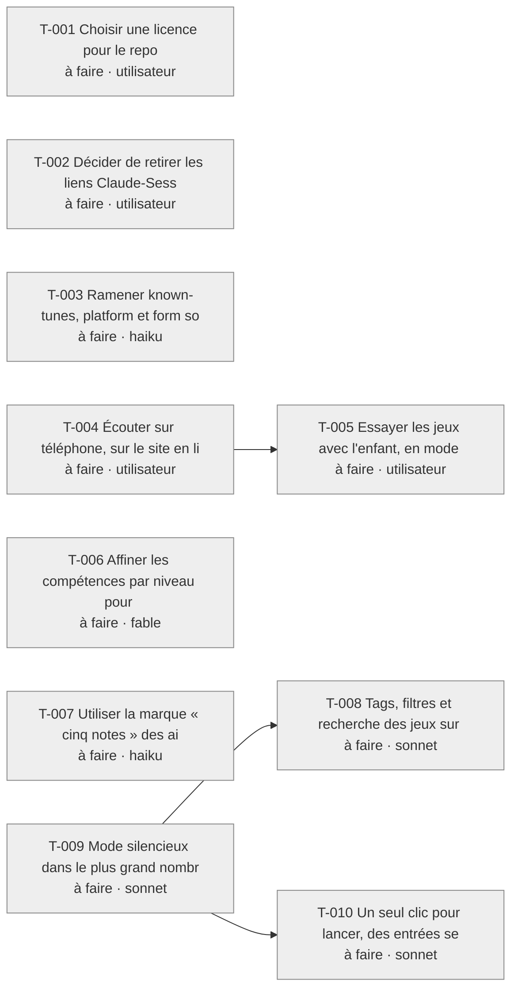

# Tableau des tâches

<!-- Généré par `node tools/status.mjs` depuis docs/project/tickets/T-*.md : ne pas modifier à la main. -->

En cours ou à faire : 10 · faits : 0

| Ticket | Titre | État | Modèle | Dépend de | Date · commit |
|---|---|---|---|---|---|
| [T-001](tickets/T-001-choisir-licence.md) | Choisir une licence pour le repo | à faire | utilisateur |  | 2026-11-18 |
| [T-002](tickets/T-002-historique-git.md) | Décider de retirer les liens Claude-Session de l'historique git | à faire | utilisateur |  | 2026-11-18 |
| [T-003](tickets/T-003-budget-tests-rapides.md) | Ramener known-tunes, platform et form sous 30 s en mode rapide | à faire | haiku |  | 2026-11-18 |
| [T-004](tickets/T-004-ecoute-telephone.md) | Écouter sur téléphone, sur le site en ligne | à faire | utilisateur |  | 2026-11-18 |
| [T-005](tickets/T-005-essai-enfant.md) | Essayer les jeux avec l'enfant, en mode encourageant | à faire | utilisateur | T-004 | 2026-11-18 |
| [T-006](tickets/T-006-competences-par-niveau.md) | Affiner les compétences par niveau pour « Aujourd'hui » | à faire | fable |  | 2026-11-18 |
| [T-007](tickets/T-007-penta-known-tunes.md) | Utiliser la marque « cinq notes » des airs connus | à faire | haiku |  | 2026-11-18 |
| [T-008](tickets/T-008-tags-filtres-recherche.md) | Tags, filtres et recherche des jeux sur l'accueil | à faire | sonnet | T-009 | 2026-11-23 |
| [T-009](tickets/T-009-mode-silencieux.md) | Mode silencieux dans le plus grand nombre de jeux possible | à faire | sonnet |  | 2026-11-23 |
| [T-010](tickets/T-010-entrees-significatives.md) | Un seul clic pour lancer, des entrées seulement quand elles ont un sens | à faire | sonnet | T-009 | 2026-11-23 |

Historique d'avant les tickets : voir [HISTORY.md](HISTORY.md).
