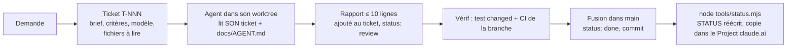

# Méthode de travail

À lire au début de chaque session, avec [STATUS.md](STATUS.md). Ce fichier change rarement.

## Fichiers

| Fichier | Rôle | Mis à jour |
|---|---|---|
| [STATUS.md](STATUS.md) | État du projet à un instant : santé, avancement, état des connaissances, prochaines étapes. ≤ 80 lignes, réécrit. | à chaque fusion dans `main` |
| [BOARD.md](BOARD.md) | Tableau des tickets + graphe des dépendances. **Généré**, ne pas éditer. | `node tools/status.mjs` |
| `tickets/T-NNN-slug.md` | Une tâche : brief, critères de fin, fichiers à lire, rapport. Modèle : [tickets/_TEMPLATE.md](tickets/_TEMPLATE.md). | création, puis fin |
| [ARCHITECTURE.md](ARCHITECTURE.md) | Structure et schémas Mermaid. | quand la structure change |
| [DECISIONS.md](DECISIONS.md) | Journal des décisions (date, décision, raison). | à chaque décision |
| [HISTORY.md](HISTORY.md) | Chantiers d'avant les tickets, une ligne chacun. | figé |

## Cycle d'une tâche

1. **Ticket avant délégation.** Copier le modèle, numéro suivant, remplir : but, critères de fin vérifiables, fichiers à lire (liste fermée), fichiers modifiables, modèle choisi.
2. **Prompt d'agent = renvoi.** « Lis `docs/AGENT.md` puis `docs/project/tickets/T-NNN-….md` et fais-le. » Pas de brief recopié dans le prompt.
3. **Isolation.** Chaque agent travaille dans un worktree git (`isolation: worktree`), sur la branche `t-NNN`, et y committe. Le dossier principal reste propre : pas de rappel de commit pendant que les agents travaillent.
4. **Rapport.** L'agent l'écrit dans la section « Rapport » du ticket, au format fixe, ≤ 10 lignes. La session principale ne le reformule pas : elle en tire une ligne pour l'utilisateur.
5. **Vérification.** `npm run test:changed` sur la branche, puis le CI ; la suite complète seulement sur demande ou chaque semaine dans le CI.
6. **Fusion.** Dans `main`, commit préfixé `T-NNN:`. Le ticket passe en `done` avec la date et le commit.
7. **État.** `node tools/status.mjs --ci`, puis réécrire la partie analyse de STATUS.md (connaissances, prochaines étapes), puis copier STATUS.md dans le Project claude.ai (`claude/STATUS.md`).

Pas de mise à jour des fichiers de projet à chaque commit intermédiaire : seulement aux étapes 1, 4, 6 et 7.

## Choix du modèle

| Tâche | Modèle |
|---|---|
| Routine : commit, tableau, renommage, petit correctif dans un seul fichier | Haiku |
| Plusieurs fichiers, tests, outillage, nouveau jeu sur un modèle existant | Sonnet |
| Justesse musicale délicate : mélodies réelles, harmonie, contrepoint | Opus |
| Conception, cahier des charges, arbitrage pédagogique | Fable |

## Économie de tokens

- Une session par chantier ; elle démarre sur STATUS.md + WORKFLOW.md + le ticket, pas sur l'historique.
- Un seul bilan à l'utilisateur quand un lot d'agents a fini ; entre-temps, l'avancement se lit dans BOARD.md.
- Au plus **2 agents qui lancent des tests en même temps** (2 CPU : au-delà, faux échecs).
- Les chiffres (commit, comptes, tests, CI, tickets) viennent de `tools/status.mjs`, jamais rédigés à la main.
- Sorties de tests : la ligne de bilan seulement ; les logs restent dans `tools/.logs/`.
- Réponses courtes : le résultat d'abord, sans répéter ce que le tableau ou le ticket dit déjà.
